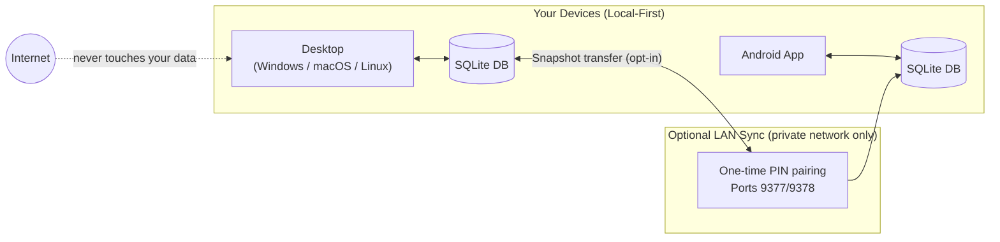

# The Mainframe

[](https://github.com/karefined-eng/the-mainframe/actions/workflows/desktop.yml)
[](https://github.com/karefined-eng/the-mainframe/actions/workflows/android.yml)
[](LICENSE)
[](https://v2.tauri.app/)

> **Your calm command center for everything you're learning, building, pursuing, and acquiring.**

A **private, offline-first** life management app for desktop and Android.  
No account required. No cloud. Your data stays on your devices — always.


---

## Why The Mainframe

Most productivity tools are either generic task lists or broad cloud platforms. The Mainframe is a **focused, privacy-first alternative**:

- **Local-first and offline** — your database lives on your device, not a server
- **Five connected domains** — courses & certifications, build ideas, acquisitions, long-term goals, and ventures
- **Plain-text capture** — paste an unstructured wall of text and turn it into organized, browsable rows in seconds
- **What's Hot dashboard** — an urgency-scored view surfaces what actually needs attention across all your domains
- **Optional LAN sync** — move a bounded snapshot between your devices over a trusted local network with a one-time PIN — no cloud intermediary
- **Cross-platform** — one Tauri v2 codebase builds for Windows, macOS, Linux, and Android



---

## Platform Support

| Platform | Deliverable | Status |
|---|---|---|
| Windows 10/11 | Desktop installer via GitHub Actions | ✅ Build target |
| macOS | `.app` / `.dmg` via GitHub Actions | ✅ Build target · signing/notarization pending |
| Linux | AppImage / `.deb` via GitHub Actions | ✅ Build target · test on target distros |
| Android | Signed release APK or debug APK | ✅ Build target · Play Store bundle pending |
| iOS | — | Planned evaluation |

> **Early public release.** Builds are available as GitHub Actions artifacts while the first stable, signed release is prepared. See [Download a build](#download-a-build).

---

## Download a Build

1. Open the [Desktop builds workflow](../../actions/workflows/desktop.yml) or [Android APK workflow](../../actions/workflows/android.yml)
2. Click a successful run
3. Download the artifact for your platform

These are CI artifacts, not yet versioned GitHub Releases. Each platform still needs real-device testing and platform-specific signing before wider distribution.

---

## Quick Start (Contributors)

### Prerequisites

- [Node.js 18+](https://nodejs.org/)
- [Rust via rustup](https://rustup.rs/)
- [Tauri v2 platform dependencies](https://v2.tauri.app/start/prerequisites/)
- Android Studio + Android SDK (Android builds only)

### Run locally

```bash
git clone https://github.com/karefined-eng/the-mainframe.git
cd the-mainframe
npm install

# Desktop dev server
npm run tauri dev

# Android dev (connect device or start emulator first)
npm run tauri android dev
```

### Run tests

```bash
node --experimental-strip-types --test tests/*.test.ts
```

### Build

```bash
npm run build          # frontend type-check + bundle
npm run tauri build    # native desktop bundle
npm run tauri android build -- --target aarch64 --apk  # Android APK
```

If you cannot install native dependencies locally, the GitHub Actions workflows build from a clean runner — fork the repo, push a branch, and download the artifact.

---

## Data & Sync Boundaries

The default workflow is **fully local and offline**. Each device has its own SQLite database with Write-Ahead Logging (WAL).

Mainframe provides direct device-to-device local synchronization with two operational modes:

| Mode | Behavior | Best For |
|---|---|---|
| **Bidirectional Merge** *(Recommended)* | Non-destructive differential exchange (`POST /sync/exchange`). Combines additions and newer edits from both devices without either device overwriting the other. | Day-to-day use across PC and Mobile |
| **Mirror Snapshot** | Atomic snapshot replacement with automatic pre-merge backup (`mainframe_backup_<timestamp>.db`). | Fresh installs or one-way device restores |

### Sync Network Constraints

| Constraint | Detail |
|---|---|
| Network scope | Private/local addresses only (RFC 1918) or wired USB (`adb reverse tcp:9377 tcp:9377`) |
| Authentication | Six-digit one-time PIN bearer token, rotates after completed sync |
| Transfer limit | 64 MiB maximum payload |
| Validation | SQLite schema dynamic column mapping + integrity checks |
| Transport | HTTP cleartext on trusted local network or USB reverse proxy |
| Ports | 9377 (transfer / exchange), 9378 (UDP discovery beacon) |

⚠️ Do not expose sync ports to the public Internet or treat local sync as an external cloud backup.

See [docs/handoff/2026-10-14-bidirectional-merge-sync.md](docs/handoff/2026-10-14-bidirectional-merge-sync.md) for full protocol architecture.

---

## Technology

| Layer | Stack |
|---|---|
| App framework | [Tauri v2](https://v2.tauri.app/) |
| Backend / sync | Rust (`tiny_http`, `ureq`, `rusqlite`) |
| Frontend | React 19, TypeScript, Vite, Tailwind CSS v4 |
| Database | SQLite via `tauri-plugin-sql` |
| Mobile | Android (aarch64) via Tauri Android |
| Icons | `lucide-react` |

---

## Project Documentation

| Document | Purpose |
|---|---|
| [Project brief](00_PROJECT_BRIEF.md) | Product scope and design decisions |
| [Data schema](01_DATA_SCHEMA.md) | SQLite table definitions and migrations |
| [Tech stack and setup](02_TECH_STACK_AND_SETUP.md) | Toolchain and build configuration |
| [Notification engine](06_NOTIFICATION_ENGINE.md) | Urgency scoring algorithm |
| [Android production guide](10_ANDROID_PRODUCTION_READINESS.md) | Signing, distribution, device testing |
| [Security Review](SECURITY-REVIEW.md) | Security audit findings and disposition |
| [Agent docs (AGENTS.md)](docs/AGENTS.md) | Architecture map and environment traps for AI agents |

The generated Android project under `src-tauri/gen/android` is committed because CI builds directly from it. Regenerate it only when changing Android configuration, then review the diff carefully.

---

## Roadmap

- [ ] Test desktop installers on Windows, macOS, and Linux environments
- [ ] macOS signing / notarization and Windows / Linux distribution hardening
- [ ] Android device testing: install, upgrade, lifecycle, and LAN sync
- [ ] Encrypted transport for LAN sync
- [ ] Versioned release artifacts with changelogs and privacy documentation
- [ ] iOS support evaluation

---

## Contributing

Contributions are welcome. Please read [CONTRIBUTING.md](CONTRIBUTING.md) before opening a pull request.

When filing an issue, include your platform, app version or commit, reproduction steps, and relevant logs.  
**Do not attach database files or screenshots containing personal data.**

---

## License

This project is licensed under the MIT License — see [LICENSE](LICENSE) for details.
