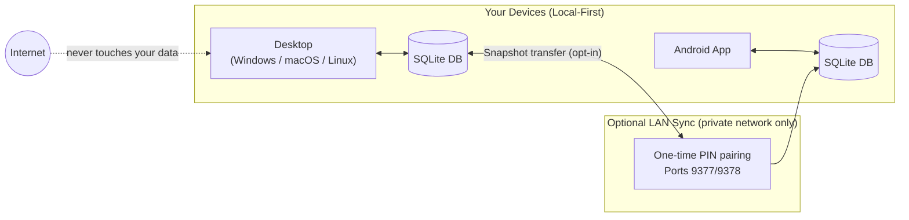

# The Mainframe

[](https://github.com/karefined-eng/the-mainframe/actions/workflows/desktop.yml)
[](https://github.com/karefined-eng/the-mainframe/actions/workflows/android.yml)
[](LICENSE)
[](https://v2.tauri.app/)

> **Your life isn't a flat list. It's five parallel tracks — each with its own calm, private home.**

A **private, offline-first personal dashboard** for Windows, macOS, Linux, and Android.  
Zero accounts. Zero cloud lock-in. Zero subscription fees. No-shame Neuro-UX design.


---

## Why The Mainframe

Your course notes live in one app. Your prototype ideas sit in GitHub issues and old chats. Your gear research is scattered across a dozen open tabs. Your ambitions didn't scatter because you're disorganized — they scattered because no tool was built to hold all of them at once.

The Mainframe is built on one opinion: **your life isn't a flat list. It's five parallel tracks** — Courses & Certifications, Build Ideas, Ventures, Goals, and Acquisitions — each with its own home, its own cadence, and nothing to configure.

Three moments define the app:

1. **The paste.** Dump a raw brain-dump from Apple Notes, WhatsApp, or your clipboard. Every line becomes a structured card in the right domain in seconds, original text preserved.
2. **The return.** Come back after three weeks to a calm "continue where you left off." No red badges, no broken streaks, no wall of overdue guilt.
3. **The exit.** Your data is a single SQLite file on your machine. No account, no cloud lock-in, no subscription — free and open source, forever.

### How The Mainframe Compares

| Feature / Trait | Standard To-Do Apps (Todoist, TickTick) | Database Builders (Notion, Anytype) | The Mainframe |
|---|---|---|---|
| **Data Storage** | Proprietary Cloud | Cloud / Complex Hybrid | **100% Local SQLite (Offline-First)** |
| **Pricing** | Monthly Subscription ($4–$10/mo) | Free tier with paid walls | **100% Free & Open Source (FOSS)** |
| **Setup Time** | Minimal (flat lists) | Hours of template tuning | **Instant (5 Pre-modeled Domains)** |
| **Overdue Handling** | Punitive red badges & broken streaks | Manual formula / user-built | **Neuro-UX: Neutral re-entry (No shame)** |
| **Cross-Device Sync** | Centralized cloud server | Cloud sync | **P2P LAN / USB Bidirectional Merge** |
| **Scope of Life** | Flat chores & checklists | Requires relational schemas | **Courses, Goals, Ideas, Ventures, Purchases** |

### Core Pillars
- **Strict Chunking & No-Shame Re-entry (Neuro-UX)** — Working memory is respected by capping high-priority focus to 3–5 items. Returning after time away is met with neutral, supportive prompts ("needs attention", "continue where you left off") rather than an accusation wall.
- **Five Pre-Structured Domains** — Instant homes for Courses & Certifications, Build Ideas, Acquisitions, Long-Term Goals, and Ventures with zero database setup.
- **3-Second Plaintext Capture** — Paste unformatted text dumps from Apple Notes, WhatsApp, or Google Docs; The Mainframe parses them directly into structured cards without retyping.
- **Sovereign Local-First Architecture** — Your database is a local SQLite file with Write-Ahead Logging (WAL). Zero cloud telemetry, zero accounts.
- **Direct Device-to-Device Sync** — Non-destructive differential merge across PC and Android over your local Wi-Fi or wired USB (`adb reverse`). No cloud middleman.
- **Native Cross-Platform Performance** — Built with Tauri v2 (Rust backend) for ultra-low memory footprint and instant boot times on Windows, macOS, Linux, and Android.



---

## Platform Support

| Platform | Deliverable | Status |
|---|---|---|
| Windows 10/11 | NSIS Installer + MSI Package | ✅ Released — v0.1.0 |
| macOS | `.dmg` Disk Image (Apple Silicon) | ✅ Released — v0.1.0 · notarization pending |
| Linux | AppImage + `.deb` + `.rpm` | ✅ Released — v0.1.0 |
| Android | Signed Universal APK | ✅ Released — v0.1.0 · Play Store pending |
| iOS | — | Planned evaluation |

---

## Download v0.1.0

**[→ Download from GitHub Releases](https://github.com/karefined-eng/the-mainframe/releases/tag/v0.1.0)**

| Platform | Installer | Architecture |
|---|---|---|
| **Windows** | `The.Mainframe_0.1.0_x64-setup.exe` (NSIS) | x64 |
| **Windows** | `The.Mainframe_0.1.0_x64_en-US.msi` (MSI) | x64 |
| **macOS** | `The.Mainframe_0.1.0_aarch64.dmg` | Apple Silicon |
| **Linux** | `The.Mainframe_0.1.0_amd64.AppImage` | x86_64 |
| **Linux** | `The.Mainframe_0.1.0_amd64.deb` | x86_64 (Debian/Ubuntu) |
| **Linux** | `The.Mainframe-0.1.0-1.x86_64.rpm` | x86_64 (Fedora/RHEL) |
| **Android** | `app-universal-release.apk` (signed APK) | arm64 / universal |

> **Note on security warnings:** Windows and macOS will show a first-launch security prompt for this release — the builds are not yet notarized/EV signed. On Windows click **"Run Anyway"** and on macOS right-click → **Open**. This is expected and safe.

---

## Quick Start (Contributors)

### Prerequisites

- [Node.js 18+](https://nodejs.org/)
- [Rust via rustup](https://rustup.rs/)
- [Tauri v2 platform dependencies](https://v2.tauri.app/start/prerequisites/)
- Android Studio + Android SDK (Android builds only)

### Run locally

```bash
git clone https://github.com/karefined-eng/the-mainframe.git
cd the-mainframe
npm install

# Desktop dev server
npm run tauri dev

# Android dev (connect device or start emulator first)
npm run tauri android dev
```

### Run tests

```bash
node --experimental-strip-types --test tests/*.test.ts
```

### Build

```bash
npm run build          # frontend type-check + bundle
npm run tauri build    # native desktop bundle
npm run tauri android build -- --target aarch64 --apk  # Android APK
```

If you cannot install native dependencies locally, the GitHub Actions workflows build from a clean runner — fork the repo, push a branch, and download the artifact.

---

## Data & Sync Boundaries

The default workflow is **fully local and offline**. Each device has its own SQLite database with Write-Ahead Logging (WAL).

Mainframe provides direct device-to-device local synchronization with two operational modes:

| Mode | Behavior | Best For |
|---|---|---|
| **Bidirectional Merge** *(Recommended)* | Non-destructive differential exchange (`POST /sync/exchange`). Combines additions and newer edits from both devices without either device overwriting the other. | Day-to-day use across PC and Mobile |
| **Mirror Snapshot** | Atomic snapshot replacement with automatic pre-merge backup (`mainframe_backup_<timestamp>.db`). | Fresh installs or one-way device restores |

### Sync Network Constraints

| Constraint | Detail |
|---|---|
| Network scope | Private/local addresses only (RFC 1918) or wired USB (`adb reverse tcp:9377 tcp:9377`) |
| Authentication | Six-digit one-time PIN bearer token, rotates after completed sync |
| Transfer limit | 64 MiB maximum payload |
| Validation | SQLite schema dynamic column mapping + integrity checks |
| Transport | HTTP cleartext on trusted local network or USB reverse proxy |
| Ports | 9377 (transfer / exchange), 9378 (UDP discovery beacon) |

⚠️ Do not expose sync ports to the public Internet or treat local sync as an external cloud backup.

See [docs/handoff/2026-10-14-bidirectional-merge-sync.md](docs/handoff/2026-10-14-bidirectional-merge-sync.md) for full protocol architecture.

---

## Technology

| Layer | Stack |
|---|---|
| App framework | [Tauri v2](https://v2.tauri.app/) |
| Backend / sync | Rust (`tiny_http`, `ureq`, `rusqlite`) |
| Frontend | React 19, TypeScript, Vite, Tailwind CSS v4 |
| Database | SQLite via `tauri-plugin-sql` |
| Mobile | Android (aarch64) via Tauri Android |
| Icons | `lucide-react` |

---

## Project Documentation

| Document | Purpose |
|---|---|
| [Project brief](00_PROJECT_BRIEF.md) | Product scope and design decisions |
| [Data schema](01_DATA_SCHEMA.md) | SQLite table definitions and migrations |
| [Tech stack and setup](02_TECH_STACK_AND_SETUP.md) | Toolchain and build configuration |
| [Notification engine](06_NOTIFICATION_ENGINE.md) | Urgency scoring algorithm |
| [Android production guide](10_ANDROID_PRODUCTION_READINESS.md) | Signing, distribution, device testing |
| [Security Review](SECURITY-REVIEW.md) | Security audit findings and disposition |
| [Agent docs (AGENTS.md)](docs/AGENTS.md) | Architecture map and environment traps for AI agents |

The generated Android project under `src-tauri/gen/android` is committed because CI builds directly from it. Regenerate it only when changing Android configuration, then review the diff carefully.

---

## Roadmap

- [x] v0.1.0: Windows, macOS, Linux, and Android release builds via GitHub Actions CI
- [x] v0.1.0: Bidirectional non-destructive LAN/USB P2P sync
- [x] v0.1.0: Neuro-UX attention dashboard (urgency scoring, strict chunking, no-shame re-entry)
- [x] v0.1.0: Plain-text bulk import parser
- [ ] macOS notarization + Windows EV code signing
- [ ] Android Play Store distribution + iOS evaluation
- [ ] Universal quick-add capture bar (global hotkey / share target)
- [ ] Snooze / "Not relevant anymore" blunt re-entry mechanic
- [ ] Encrypted sync transport for WAN use cases
- [ ] First-run sample workspace (pre-populated with examples)

---

## Contributing

Contributions are welcome. Please read [CONTRIBUTING.md](CONTRIBUTING.md) before opening a pull request.

When filing an issue, include your platform, app version or commit, reproduction steps, and relevant logs.  
**Do not attach database files or screenshots containing personal data.**

---

## License

This project is licensed under the MIT License — see [LICENSE](LICENSE) for details.
