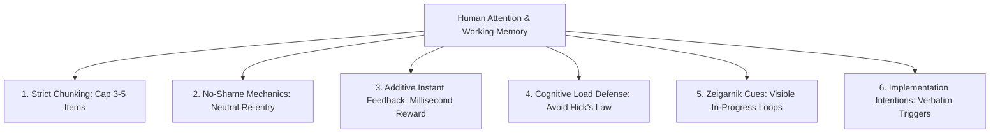

# Neuro-UX & Cognitive Psychology Research

**Location:** `docs/research/01_NEURO_UX_AND_COGNITIVE_PSYCHOLOGY.md`  
**Author:** Antigravity AI & Founder  
**Grounded in:** [origin.md](file:///c:/Users/asamoah/the-mainframe/origin.md), Cognitive Load Theory (Sweller), Working Memory Capacity (Cowan), Implementation Intentions (Gollwitzer), and ADHD executive function discourse.

---

## 1. The Core Psychological Premise

In [origin.md](file:///c:/Users/asamoah/the-mainframe/origin.md), the foundational emotional need for The Mainframe was recorded:
> *"Seeing everything unfinished at once can be heavy; the system should help me choose and continue, not make the whole list feel like a verdict... I wanted one private home for that information, under my control and available across devices. More importantly, I did not want a strict schedule or a single ranking to declare which part of my life mattered most."*

Most task management and productivity tools trigger cognitive fatigue and abandonment because they violate fundamental principles of human neuropsychology. They treat task management as an accounting spreadsheet or an accountability drill instructor, rather than a cognitive prosthetic.

---

## 2. Theoretical Frameworks & Cognitive Foundations

### A. Working Memory Constraints (Cowan's 3–5 Chunks vs. Miller's 7±2)
- **The Classical Myth:** George Miller's 1956 paper suggested human working memory holds $7 \pm 2$ items.
- **Modern Consensus (Nelson Cowan, 2001):** Under active cognitive load, real working memory capacity is strictly **3 to 5 discrete chunks**.
- **The Failure Mode:** When an app displays a flat list of 20–50 items, working memory collapses. The brain registers the list not as discrete tasks, but as a diffuse, threatening "wall of demands."
- **The Mainframe Rule:** High-priority focus areas (such as the **What's Hot** dashboard) must be **hard-capped at 3 to 5 items**. Additional items must be progressively disclosed only upon explicit user request.

### B. The Shame Spiral & Dopamine Deficit (ADHD & Overwhelm Dynamics)
- **The Mechanism:** Standard productivity apps use punitive feedback loops:
  - Overdue dates marked in aggressive red text.
  - Streak counters that reset to zero on missed days.
  - Notification badges displaying high overdue counts (e.g., "14 Overdue").
- **The Neurological Trap:** For neurodivergent minds (ADHD, executive dysfunction) and burnt-out professionals, shame is an unsustainable fuel. While acute panic can temporarily trigger adrenaline to overcome task paralysis, repeated shame triggers the **Freeze Response** (amygdala hijack). The user equates opening the app with receiving a moral indictment, triggering avoidance behavior and complete app abandonment.
- **The Mainframe Rule:** **Zero Shame Mechanics.**
  - No broken streaks. No flashing red text.
  - Overdue tasks are presented with **blunt, neutral re-entry cues** (e.g., *"Needs attention"*, *"Continue where you left off"*).
  - Returning after 3 weeks of absence must feel supportive, calm, and frictionless—never an accusation.

### C. The Zeigarnik Effect (Open Loops vs. Cognitive Debt)
- **The Principle (Bluma Zeigarnik, 1927):** Unfinished tasks occupy active mental bandwidth because the brain maintains them as unclosed loops.
- **The Design Implication:** If an app tries to hide unfinished work completely, the user experiences background anxiety. If it shows all unfinished work at once, the user experiences panic.
- **The Mainframe Solution:** Surfacing in-progress items prominently with clear, concrete status indicators gives the brain permission to park the open loop without losing track of it.

### D. Implementation Intentions (Peter Gollwitzer, 1999)
- **The Research:** Broad intentions (e.g., *"Work on certification"*) have an execution failure rate exceeding 60%. When paired with a concrete implementation intention (*"When X happens, in situation Y, I will do Z"*), execution probability doubles.
- **The Mainframe Rule:** When an item has an `action_trigger` (the user's specified when/where/how context), it **MUST be displayed verbatim**. Never truncate, sanitize, or replace user implementation triggers with generic labels.

---

## 3. Strict Neuro-UX Design Constraints for The Mainframe

All future agents, designers, and contributors working on the frontend MUST adhere to these six neurological constraints:

1. **Strict Chunking (Working Memory Defense):** Never display an uncapped, unchunked wall of tasks. The primary dashboard view must restrict urgent items to 3–5 items.
2. **No-Shame Re-entry (Blunt Neutrality):** Never use punitive visual alerts, broken streak badges, or moralistic copy. When items are overdue, state the facts plainly without judgment.
3. **Immediate Additive Feedback:** The exact millisecond an item is checked or updated, provide instant visual feedback (smooth strikethrough, clean micro-transition). Do not require network roundtrips.
4. **Avoid Hick's Law Fatigue:** Do not build complex tag clouds, multi-nested sorting dropdowns, or endless filtering trees. Rely on pre-structured life domains and automated urgency scoring.
5. **Preserve Zeigarnik Cues:** Prominently highlight items marked `in_progress` to keep momentum alive without overwhelming the user.
6. **Preserve Implementation Intentions:** Always surface user-defined context triggers (`action_trigger`) verbatim.

---

## 4. UI Copy Translation Dictionary (Neuro-UX Certified)

| Standard / Punitive Copy | Neuro-UX Certified Mainframe Copy | Psychological Impact |
|---|---|---|
| *"Overdue (18)"* | **"Needs attention (3)"** | Eliminates panic and avoidance response. |
| *"You missed these deadlines"* | **"Continue where you left off"** | Re-opens constructive engagement loop. |
| *"Streak broken! 0 days"* | *(Streak omitted entirely)* | Removes moralistic gamification. |
| *"Urgent / Critical"* | **"High priority"** | Lowers cortisol and emotional reactivity. |
| *"Backlog"* | **"Future tracks"** or **"Parked ideas"** | Reframes unstarted work as assets, not debts. |
| *"Paste Import Tool"* | **"Bring in an existing list"** | Removes technical jargon; invites quick action. |

---

## 5. Architectural Invariants for Future Agents

- **Rule 1:** NEVER add streak counters or punitive overdue animations.
- **Rule 2:** NEVER remove the 3–5 item chunking cap on the What's Hot dashboard.
- **Rule 3:** NEVER replace the 5 pre-structured domains with a generic empty canvas.
- **Rule 4:** ALWAYS provide instant client-side feedback for all item state mutations.
