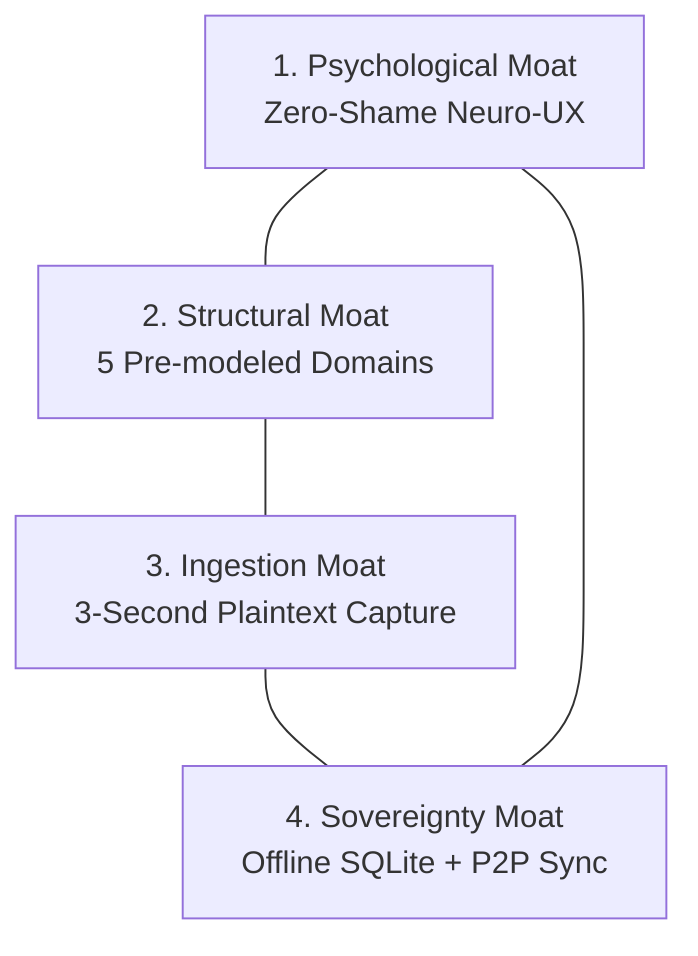

# Competitive Moat & Market Positioning Research

**Location:** `docs/research/02_COMPETITIVE_MOAT_AND_POSITIONING.md`  
**Author:** Antigravity AI & Founder  
**Grounded in:** [origin.md](file:///c:/Users/asamoah/the-mainframe/origin.md), [11_MARKET_AND_PRODUCT_RESEARCH.md](file:///c:/Users/asamoah/the-mainframe/11_MARKET_AND_PRODUCT_RESEARCH.md), competitive teardowns of Notion, Obsidian, Todoist, Anytype, and LocalSend.

---

## 1. The Market Vacuum

In the productivity and task management landscape, users are constantly pushed between two extremes, both of which inevitably fail ambitious builders:

```
                  ┌──────────────────────────────────────────────┐
                  │                 HIGH COMPLEXITY              │
                  │                                              │
                  │   Notion / Obsidian / Anytype                │
                  │   (Endless setup, database maintenance)      │
                  │                                              │
  CLOUD-LOCKED   │                                              │  LOCAL-FIRST /
  & SURVEILLED    │                        ★ THE MAINFRAME       │  SOVEREIGN
                  │                        (Zero setup, calm     │
                  │                         structured domains)  │
                  │   Todoist / TickTick                         │
                  │   (Shame badges, streaks, flat lists)        │
                  │                                              │
                  │                 LOW COMPLEXITY               │
                  └──────────────────────────────────────────────┘
```

### Extreme A: The Flat Checklist Trap (Todoist, TickTick, Apple Reminders)
- **The Pitch:** Quick to start, easy checkboxes.
- **The Reality:** Real life is not a flat grocery list. Solo builders, engineers, and creators have parallel tracks: software prototypes, learning paths, business ventures, financial goals, and gear research.
- **The Fatal Flaws:**
  - Flat lists collapse nuance (a 6-month software prototype looks identical to "buy almond milk").
  - Overdue shame mechanics (red badges, broken streaks, rolling dates) induce anxiety and app abandonment.
  - Proprietary cloud lock-in with mandatory monthly subscriptions ($4–$10/mo).

### Extreme B: The Modular Setup Trap (Notion, Obsidian, Anytype, Coda)
- **The Pitch:** "Build your ideal Second Brain with infinite flexibility."
- **The Reality:** Infinite blank-canvas freedom leads to the **Setup Procrastination Trap**. Users spend 30 hours designing relational database schemas, writing custom formulas, configuring YAML frontmatter, and tuning canvas layouts instead of executing work.
- **The Fatal Flaws:**
  - Maintenance overhead exceeds the practical utility.
  - Laggy cloud performance (Notion) or plugin compatibility breaks (Obsidian).
  - High friction for spontaneous mobile capture.

---

## 2. Competitive Teardown Matrix

| Feature / Trait | Standard To-Do Apps (Todoist, TickTick) | Database Builders (Notion, Anytype) | The Mainframe |
|---|---|---|---|
| **Data Architecture** | Proprietary Centralized Cloud | Cloud or Hybrid Graph | **100% Local SQLite (Offline-First)** |
| **Monetization** | Monthly Subscription ($4–$10/mo) | Free tier with paid barriers | **100% Free & Open Source (FOSS)** |
| **Time to First Value** | Instant (flat checklists) | 10–40 hours (template setup) | **Instant (5 Pre-modeled Domains)** |
| **Overdue Mechanics** | Punitive red badges & broken streaks | User-configured formulas | **Neuro-UX: Neutral re-entry (No shame)** |
| **Cross-Device Sync** | Central cloud server | Cloud sync | **P2P LAN / USB Bidirectional Merge** |
| **Cognitive Scope** | Flat chores | Relational database tables | **Pre-structured parallel life tracks** |
| **Raw Ingestion** | Manual single task entry | Manual page/database creation | **3-Second Plaintext Brain Dump Parser** |
| **Client Memory Footprint**| 150–400 MB (Electron / Web) | 300–800 MB (Electron) | **~25 MB RAM idle (Tauri v2 + Rust)** |

---

## 3. The 4-Pillar Defensible Moat

Individually, SQLite, Tauri v2, and LAN sync are technical primitives. The durable moat of The Mainframe is the **tight convergence of four mutually reinforcing pillars**:



### Pillar 1: The Psychological Moat (Zero-Shame Neuro-UX)
- Designed from the ground up to prevent the "avoidance freeze" common in ADHD and burnt-out knowledge workers.
- The What's Hot dashboard is capped at 3–5 items based on human working memory limits.
- Stepping away for three weeks produces a calm, neutral re-entry view—never a wall of accusations or broken streaks.
- **Defensibility:** Competitors cannot copy this without abandoning the gamification and daily active user (DAU) retention metrics required by venture capital.

### Pillar 2: The Structural Moat (Pre-Modeled Life Domains)
- Life tracks are pre-structured out of the box:
  1. **Courses & Certifications:** Continuous skill acquisition and timeline tracking.
  2. **Build Ideas:** Software prototypes, feature backlog, execution readiness.
  3. **Ventures:** Business milestones, revenue operations, strategic initiatives.
  4. **Goals:** Target milestones with time-window scoring.
  5. **Acquisitions:** Wishlist planning and spending justification.
- **Defensibility:** Solves the blank-canvas paralysis of Notion while preserving the distinct identity of parallel life tracks that flat task apps destroy.

### Pillar 3: The Ingestion Moat (3-Second Plaintext Capture)
- Inspiration arrives anywhere. A user should never have to stop, navigate a 4-level menu, or assign 6 database properties just to record a thought.
- Paste messy, unformatted text dumps directly from Apple Notes, WhatsApp, or Google Docs; each line becomes a structured card in the correct domain instantly.
- The original raw text is always preserved for traceability.
- **Defensibility:** Eliminates the highest-friction barrier in productivity tools: the dread of manual data entry.

### Pillar 4: The Sovereignty & Speed Moat (Offline SQLite + P2P Sync)
- Built on Tauri v2 (Rust) with a local SQLite database utilizing Write-Ahead Logging (WAL).
- Zero cloud servers, zero telemetry, zero mandatory accounts.
- Direct device-to-device synchronization over local Wi-Fi or wired USB (`adb reverse tcp:9377 tcp:9377`) using non-destructive differential merge.
- Boots in under 500ms; consumes ~25 MB RAM idle.
- **Defensibility:** Users own their data forever by physics, not by privacy policies. Immune to cloud outages, subscription price hikes, or API deprecations.

---

## 4. Product Strategy Guidance for Future Features

When evaluating future feature proposals, future agents and contributors must test against this moat framework:

1. **Does it add setup friction?** If a proposed feature requires users to design databases or write configuration schemas, **reject it**. Maintain pre-structured opinionation.
2. **Does it introduce shame mechanics?** If a proposal introduces streaks, flashing red alerts, or guilt-inducing notifications, **reject it**.
3. **Does it require cloud infrastructure?** If a feature depends on a hosted server or external database, **reject it**. All sync and storage must remain peer-to-peer and local-first.
4. **Does it preserve instant capture?** Any new domain or feature must support raw, unformatted plaintext ingestion in 3 seconds or less.
